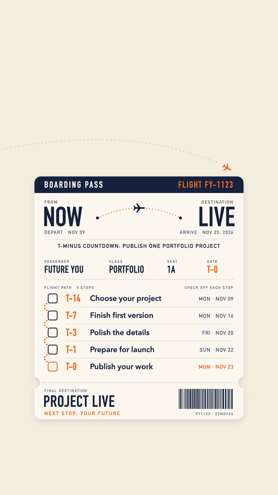

# Boarding Pass to Future You

A countdown phone lock screen for one goal: **publish one portfolio project by November 23, 2026.**

The countdown is designed as a boarding pass from NOW to PROJECT LIVE, with five T-minus milestones joined by a dotted flight path.

## Milestones

| Countdown | Date | Milestone |
| --- | --- | --- |
| T-14 | Mon, Nov 9, 2026 | Choose your project |
| T-7 | Mon, Nov 16, 2026 | Finish first version |
| T-3 | Fri, Nov 20, 2026 | Polish the details |
| T-1 | Sun, Nov 22, 2026 | Prepare for launch |
| T-0 | Mon, Nov 23, 2026 | Publish your work |

## Design

- Format: vertical 9:16 phone lock screen, 1440 × 2560 px
- Palette: ivory background, midnight-blue details, orange accents
- Layout: the top third is left clear for the clock and widgets, and the bottom edge for the flashlight and camera buttons. The ticket sits in the center so it isn't cut off on taller phones.
- Tip: set the phone's lock screen clock to a dark color so it reads clearly on ivory.

## Files

| File | What it is |
| --- | --- |
| `lock-screen.png` | The lock screen wallpaper (1440 × 2560, 9:16) |
| `preview-cover.png` | Preview cover (1200 × 800, 3:2) |
| `title.txt` | Project title |
| `description.txt` | Project description (441 characters) |
| `details.md` | Submission sheet for the Handshake form |

Next stop: your future.
